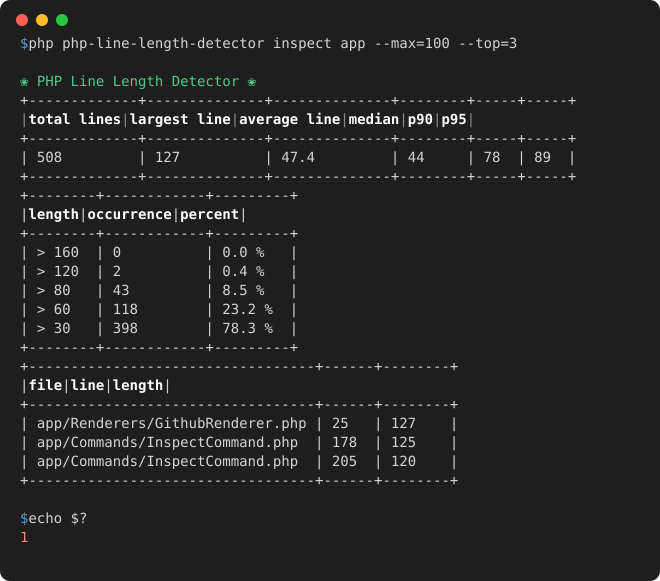

<p align="center">

</p>

<p align="center">
<a href="https://github.com/DeGraciaMathieu/php-line-length-detector/actions/workflows/testing.yml"></a>


</p>

<h1 align="center">php-line-length-detector</h1>

<p align="center"><b>Find the lines that make you scroll sideways, and stop new ones from reaching your main branch.</b></p>

<p align="center">

</p>

A long line is rarely just long: it often hides a condition doing too much, a call chain begging for a variable, a signature with too many parameters. This tool shows you **how wide your code really is**, **where it overflows**, and **fails your CI** when it gets worse.

## ⚡ Quick start

```bash
wget https://github.com/DeGraciaMathieu/php-line-length-detector/raw/master/builds/php-line-length-detector
php php-line-length-detector inspect app --max=120
```

That's it: every line wider than 120 columns is listed, longest first, and the command exits with `1`.

## ✨ Features

- 📏 **Real width**: indentation counted, tabs expanded, accents count as one character. What you measure is what your editor shows.
- 📊 **The full picture**: average, median, p90 and p95, plus how many lines cross each threshold.
- 🎯 **Pinpoint**: `file:line` of every offender, and a ranking of the worst files with `--by-file`.
- 🚦 **CI ready**: exit code `1` on failure, annotations right on your pull requests, checkstyle and JSON reports.
- 🧊 **Legacy friendly**: a baseline freezes today's long lines, only new ones fail.
- ⚙️ **Configurable**: one JSON file in your project, no need to repeat the options.

## 📦 Installation

Requires PHP 8.2 or later.

**Phar (recommended)**, a single file embedding its own dependencies:

```bash
wget https://github.com/DeGraciaMathieu/php-line-length-detector/raw/master/builds/php-line-length-detector
```

**Composer**:

```bash
composer require degraciamathieu/php-line-length-detector --dev
```

> [!NOTE]
> The tool is built with Laravel Zero, so composer installs `laravel-zero/framework` and `illuminate/*` 12 packages in your project. If they conflict with your dependencies, use the phar.

## 🔍 Explore your code

```bash
php php-line-length-detector inspect app,src
```

Find the files to refactor first:

```bash
php php-line-length-detector inspect app --max=120 --by-file --top=3
```

```
+----------------------------------+-------+--------------+--------------+----------+
| file                             | lines | largest line | average line | exceeded |
+----------------------------------+-------+--------------+--------------+----------+
| app/Renderers/GithubRenderer.php | 11    | 127          | 49.9         | 1        |
| app/Commands/InspectCommand.php  | 161   | 125          | 53.7         | 1        |
| app/Bags/FileBag.php             | 27    | 118          | 43.4         | 0        |
+----------------------------------+-------+--------------+--------------+----------+
```

## 🚦 Guard your CI

With `--format=github`, every long line becomes an annotation on the pull request, right where it was written:

```yaml
# .github/workflows/line-length.yml
name: line-length

on: [pull_request]

jobs:
  line-length:
    runs-on: ubuntu-latest
    steps:
      - uses: actions/checkout@v4
      - uses: shivammathur/setup-php@v2
        with:
          php-version: '8.4'
      - run: wget -q https://github.com/DeGraciaMathieu/php-line-length-detector/raw/master/builds/php-line-length-detector
      - run: php php-line-length-detector inspect app --max=120 --format=github
```

```
::error file=app/Renderers/GithubRenderer.php,line=25::Line exceeds 120 characters; contains 127 characters
::error file=app/Commands/InspectCommand.php,line=178::Line exceeds 120 characters; contains 125 characters
```

Other CI tools? Use `--format=checkstyle` for a checkstyle report, or `--format=json` for the whole report.

## 🧊 Adopt it on a legacy project

Thousands of long lines already? Don't fix them all today. Freeze them in a baseline:

```bash
php php-line-length-detector inspect app --max=120 --generate-baseline=line-length-baseline.json
```

Then check against it: known lines are tolerated, **new ones fail**.

```bash
php php-line-length-detector inspect app --max=120 --baseline=line-length-baseline.json
```

Lines are recognized by their content, not their number, so the baseline keeps working when code moves around.

## ⚙️ Configure once

Drop a `php-line-length-detector.json` file at the root of your project:

```json
{
    "paths": ["app", "src"],
    "max": 120,
    "exclude": ["\\.blade\\.php$"],
    "baseline": "line-length-baseline.json"
}
```

And just run:

```bash
php php-line-length-detector inspect
```

Keys are the option names below, plus `paths`. Command line options always win over the file, and `--config=<file>` loads another one.

## 📚 Reference

<details>
<summary><b>All options</b></summary>

| Option | Default | Description |
|---|---|---|
| `--max=<n>` | | List the lines wider than `n` and fail if there is any |
| `--top=<n>` | | Limit the listed lines and files |
| `--by-file` | | Display a summary by file |
| `--thresholds=<list>` | `160,120,80,60,30` | Widths to count lines against |
| `--format=<format>` | `text` | `text`, `json`, `checkstyle` or `github` (the last two require `--max`) |
| `--baseline=<file>` | | Ignore the long lines listed in this baseline |
| `--generate-baseline=<file>` | | Write the current long lines into this baseline |
| `--exclude=<regex>` | | Skip files whose absolute path matches, repeatable |
| `--without-indentation` | | Do not count the indentation |
| `--tab-width=<n>` | `4` | Width of a tab |
| `--min-length=<n>` | `10` | Ignore lines shorter than this, indentation excluded |
| `--include-comments` | | Analyze comments too |
| `--config=<file>` | `php-line-length-detector.json` | Config file to load |

</details>

<details>
<summary><b>What is measured</b></summary>

- The width of a line as your editor displays it: indentation included, tabs expanded to the next tab stop, multibyte characters counted once.
- Ignored: blank lines, lines shorter than 10 characters once unindented (`}`, `return;`...), `use` imports and comments. PHP 8 attributes `#[...]` are code, so they are measured.

</details>

<details>
<summary><b>Exit codes</b></summary>

| Code | Meaning |
|---|---|
| `0` | No line exceeds `--max` |
| `1` | At least one line exceeds `--max` |
| `2` | Invalid input: path, option, config or baseline file |

</details>
